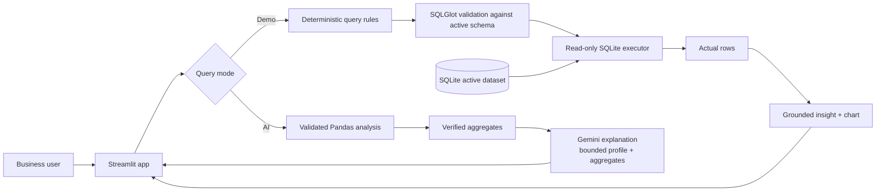

# AI Business Intelligence Copilot

**Ask questions. Get data-driven answers.**

A local Streamlit application for exploring varied CSV and Excel datasets with Pandas profiling, local calculations, plain-English questions, and schema-driven charts. It includes a synthetic orders dataset and does not require business-specific columns.

## Business problem

Business users often need simple answers from tabular data but do not know SQL. AI Mode calculates supported analyses locally with Pandas and uses Google Gemini only to explain verified results. Demo Mode retains the existing rule-based, validated read-only SQL workflow.

## Features

- A deterministic rule-based demo mode that works without an API key and is explicitly labelled as demo mode.
- Dataset-aware AI analysis using the official `google-genai` SDK: supported calculations are performed locally, then Gemini receives a bounded profile and verified aggregate results for a concise explanation.
- Bounded retries with exponential backoff and jitter for transient Gemini errors; invalid credentials and permanent request errors are not retried.
- SQLGlot parsing, one-query policy, table/column restrictions, blocked unsafe functions, query complexity bounds, and a maximum result size.
- SQLite read-only connections, an authorizer, and a query execution time budget.
- A reproducible 600-row synthetic dataset, dataset-appropriate profiling, grounded summaries, and suitable Plotly charts.
- CSV, XLSX, and XLS import with file-size, row-count, readability, and usable-table checks. Duplicate/blank headers are normalized, missing values are retained, and each upload is isolated in its own SQLite table.
- Dataset-specific profile, preview, missing-value and duplicate-row statistics, descriptive numeric statistics, generated suggested questions, and session query history.
- Schema-driven charts include date trends, category counts, numeric distributions, numeric relationships, and correlations where the data supports them.
- AI Mode supports dataset summaries, missing-value reports, numeric statistics, category comparisons, monthly trends, and numeric outlier checks; ambiguous requests ask for clarification.
- Pytest coverage for data setup, SQL restrictions, read-only execution, demo/AI response parsing, file validation, and summaries.

## Architecture



## Technology

Python 3.11+, Streamlit, SQLite, pandas, Plotly, SQLGlot, Google Gen AI Python SDK, python-dotenv, Excel readers, and pytest.

## Project structure

```text
app.py
config.py
requirements.txt
README.md
src/
  analytics.py
  audit_logger.py
  chart_builder.py
  data_loader.py
  dataset_profiler.py
  analysis_engine.py
  database.py
  llm_service.py
  query_executor.py
  schema_inspector.py
  sql_validator.py
tests/
scripts/
data/                 # Reserved for optional local data files
```

## Windows setup (PowerShell)

1. Open this folder in VS Code and use **Python: Select Interpreter** to select Python 3.11 or newer.
2. Create and activate a virtual environment:

   ```powershell
   py -3.11 -m venv .venv
   .\.venv\Scripts\Activate.ps1
   ```

   If PowerShell blocks activation, use the environment's executable directly instead of changing system execution policy:

   ```powershell
   .\.venv\Scripts\python.exe -m pip install -r requirements.txt
   ```

3. Install dependencies:

   ```powershell
   python -m pip install -r requirements.txt
   ```

4. Check the selected environment:

   ```powershell
   python .\scripts\validate_environment.py
   ```

5. Initialize the database (safe to rerun; existing tables are not dropped):

   ```powershell
   python -m scripts.create_sample_data
   ```

6. Start the app:

   ```powershell
   streamlit run .\app.py
   ```

7. Run tests:

   ```powershell
   python -m pytest
   ```

If local execution is blocked by an application-control policy or a native DLL failure, use an administrator-approved Python environment or a supported managed development environment. Do not disable security controls or download replacement DLLs from unofficial sources.

### Native DLL / Application Control troubleshooting

Validation in the current workspace found Python 3.13.12 and `pyarrow` 26.0.0. Streamlit's interactive DataFrame renderer attempts to import `pyarrow.lib`, and Windows reported `DLL load failed while importing lib: An Application Control policy has blocked this file.` The data-query path still works; the app falls back to showing the actual results as JSON when the interactive table cannot load. A grouped chart also rendered during the Streamlit app check. No package reinstall or security-policy change was attempted. Use an approved interpreter/environment, or ask the administrator to review the blocked module using the organization-approved process.

## AI configuration

Demo Mode requires no secrets or network access. Configure Google Gemini by copying the safe template to `.env`:

```powershell
Copy-Item .\.env.example .\.env
```

Edit `.env` locally and set `GOOGLE_API_KEY` to your Google AI Studio API key. Never paste it into chat or commit it.

The app loads `.env` from the project root with `python-dotenv`; a process-level `GOOGLE_API_KEY` takes precedence, and Streamlit secrets are a fallback. The sidebar identifies the key source without displaying the credential. `GEMINI_MODEL` is the initial configured model; it is not assumed to be available. Use **Discover available Gemini text models** to query `client.models.list()` and show only returned identifiers advertising `generateContent` that are not image-, audio-, embedding-, or other non-text-specific models. The selector retains the exact identifier returned by Google. **Test Google Gemini connection** performs a real text-generation request using the selected model and reports success only if Gemini returns text. It distinguishes invalid credentials, unavailable models, quota/rate limits, and network failures without displaying provider response details or the key. Restart Streamlit after changing `.env` or process environment variables. Keep `.env` out of source control; `.gitignore` excludes it. `.env.example` contains placeholders only.

The dashboard theme uses the reference palette (`#91B6F8`, `#B0D0F8`, `#C5E1FA`, `#B59BE4`, `#A386D9`, `#9270D2`), with white card surfaces and dark navy text.

The maximum query result size defaults to 1,000 rows and can be changed with `BI_MAX_RESULT_ROWS` (valid range: 1-10,000).

The app uses Google Gemini. Configure a Google AI Studio API key; credentials for other providers will not authenticate.

AI Mode does not ask Gemini to generate SQL. Pandas first performs a supported calculation against the active dataset. Gemini receives only a bounded profile and verified aggregate output; raw dataset rows are not sent. Sensitive-name columns are excluded from values and result columns before constructing that context. Use caution with sensitive or regulated datasets, since column names and non-sensitive aggregates may still be transmitted to Google.

## Sample questions

- What are the total sales?
- What is the total profit?
- Which category generated the highest profit?
- Which region has the highest sales?
- Compare sales across categories.
- Which customer segment is most profitable?
- What are the top five products by sales?
- Which orders made a loss?
- How do sales change over time?
- What is the average order value?
- Which category has the lowest profit margin?
- Show the ten highest-value orders.

Demo Mode is rule-based and intentionally limited to supported patterns. Suggestions are generated from the active dataset's schema. AI Mode supports local dataset summaries, missing-value analysis, numeric statistics, category comparisons, monthly trends, and outlier counts. It asks for clarification when the requested columns or intent cannot be inferred safely.

## Supported datasets

Upload CSV, XLSX, or XLS from the sidebar. Excel imports include a worksheet selector. Files are limited to 20 MB and 100,000 rows; XLSX and XLS support requires `openpyxl` and `xlrd`, installed through `requirements.txt`. No business-specific columns are required. Duplicate headers are made unique, blank headers get generated names, and missing values are reported rather than rejected. Uploaded data is stored in a dataset-specific local SQLite table; choose the active dataset in the sidebar. Uploads are not sent to Google Gemini.

## Security and data handling

- Generated SQL is parsed, restricted to a single SELECT/UNION query, checked against the active dataset's table and columns, limited, and executed on a read-only SQLite connection with an authorizer and execution budget.
- Mutating statements, system/other tables, recursive CTEs, and known dangerous SQLite functions are rejected.
- Gemini does not receive dataset records, but it does receive a bounded profile and computed aggregate results for explanations. Do not upload data you are not authorized to process or share.
- Query history exists only in the Streamlit session. Application diagnostics avoid logging result rows and credentials.
- This is a local portfolio demonstration, not a hardened multi-user or production data service. Always review generated SQL before relying on outputs.

## Screenshots

Add genuine screenshots captured from a running local instance here. Do not use mock screenshots that imply a deployment.

## Limitations and next steps

- AI Mode only computes its predefined, validated analytical operations; unsupported questions require clarification and are not passed to Gemini for arbitrary code or SQL execution.
- The AI provider is optional and requires the user's own API key and network access.
- Gemini explanations depend on the configured model, account quota, and network access. AI Mode still shows the verified local result if explanation is unavailable; the app reports a connection test as successful only after a real text-generation response.
- Uploads are limited to 20 MB and 100,000 rows. CSV, XLSX, and XLS are implemented; other formats are not supported.
- Query history is session-scoped and disappears when the browser session ends.
- A production version would need authentication, privacy controls, a stronger deployment threat model, database migrations, and provider-specific monitoring.

## Manager summary

This application lets a user profile a tabular dataset, ask a supported question, and inspect locally computed results with suitable charts. AI Mode shows verified Pandas calculations; Demo Mode additionally shows the validated SQL it executes. The built-in records are synthetic training data, not company results.
